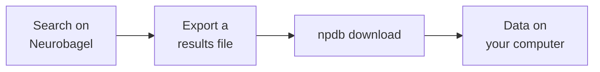

# NeuroPoly data tools

Find and download NeuroPoly imaging data in three steps: **search** the lab's datasets on the web, **export** your selection, and **download** it with one command.



New here? Read **[What's available to you](docs/overview.md)** first.

## Get started

1. **[Get access](docs/get-access.md)**: VPN, GitHub organization, NeuroGitea account and token. One-time setup.
2. **[Install npdb](docs/install.md)**: one command with [uv](https://docs.astral.sh/uv/):

   ```bash
   uv tool install "npdb[download] @ git+https://github.com/neuropoly/neuropoly-db"
   ```

3. **[Find data](docs/find-data.md)** on Neurobagel: <https://data.neuro.polymtl.ca/bagel>.
4. **[Download data](docs/download-data.md)**:

   ```bash
   npdb download --no-verify-ssl results.tsv -o my-cohort
   ```

Walk through all of it with an example: **[Tutorial: your first cohort](docs/tutorial-first-cohort.md)**.

## Going further

- **Learn how lab data is organized** (Duke, NeuroGitea, Neurobagel): [wiki tutorials](https://github.com/neuropoly/neuropoly-db/wiki).
- **Add or curate datasets** (clean up, convert, publish on Neurobagel): [wiki tutorials, parts 4 and 5](https://github.com/neuropoly/neuropoly-db/wiki/Tutorial-4-NeuroGitea-to-Neurobagel).
- **Developers** (contributing to `npdb`, running a Neurobagel node, every command and option): [wiki Development section](https://github.com/neuropoly/neuropoly-db/wiki/Development).
