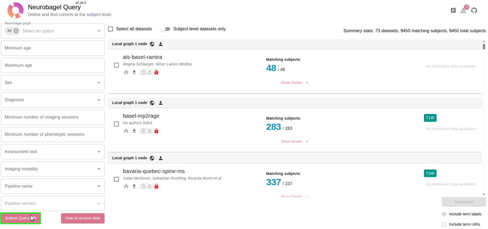

# Find data

Use the Neurobagel website to search all lab datasets at once.

> [!NOTE]
> You need the **VPN** (off campus) and to be a member of the **[neuropoly GitHub organization](https://github.com/neuropoly)**. See [Get access](get-access.md).

## 1. Open Neurobagel

Go to **<https://data.neuro.polymtl.ca/bagel>** and click **Submit Query**. With no filters, it lists every dataset.

Each card is one dataset. It shows:

- how many subjects match your search, out of the total (e.g. **305** / 449),
- the types of scans available (e.g. `T1W`, `T2W`, `DWI`).

## 2. Filter

Use the filters on the left (age, sex, diagnosis, imaging modality, ...), then click **Submit Query** again.

## 3. Export your results

Tick the box next to each dataset you want, then click **Download** (bottom right). Keep **Include term labels** selected.

You get a **results file** (`.tsv`): a table with one row per subject and session. You can open it in Excel or LibreOffice. Useful columns:

| Column | Meaning |
|--------|---------|
| `DatasetName` | Dataset the subject belongs to. |
| `SubjectID`, `SessionID` | Subject and session. |
| `Age`, `Sex`, `Diagnosis` | Subject information. |
| `SessionImagingModalities` | Types of scans in that session (`T1w`, `T2w`, ...). |

Move this file to your data folder (e.g. `~/neuropoly-data`).

Next: [Download data](download-data.md)
