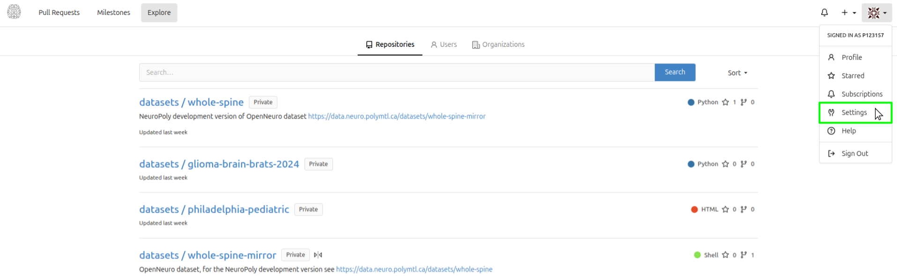
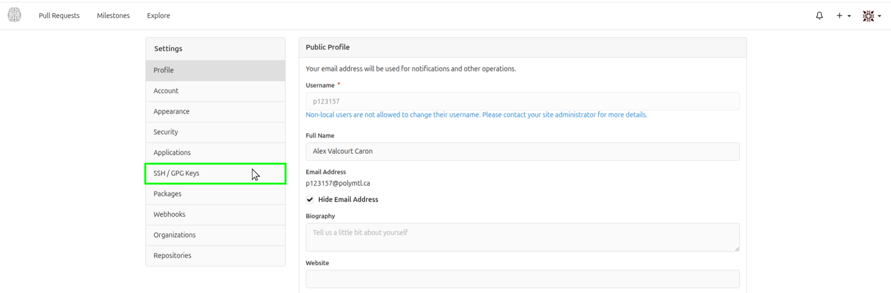
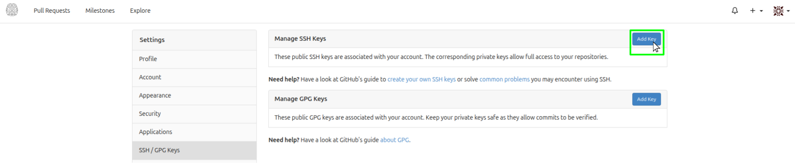
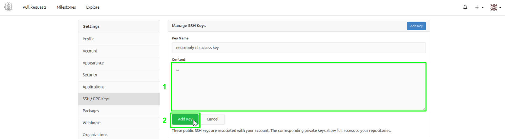
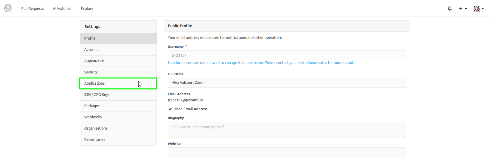
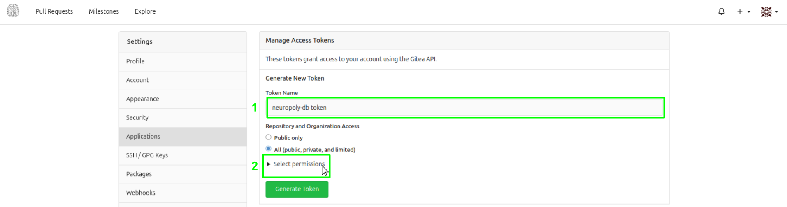
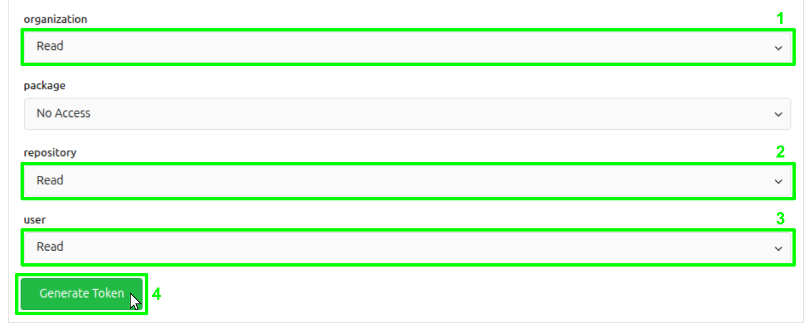
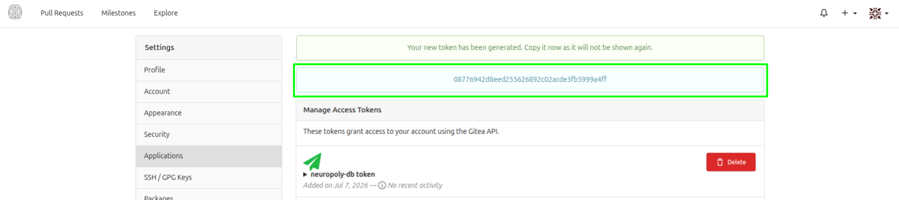

# Get access

You do this **once**. It takes about 15 minutes.

- [1. VPN and GitHub](#1-vpn-and-github)
- [2. NeuroData account](#2-neurodata-account)
- [3. Register your computer (SSH key)](#3-register-your-computer-ssh-key)
- [4. Create a download token](#4-create-a-download-token)
- [5. Save your credentials](#5-save-your-credentials)

## 1. VPN and GitHub

- Off campus, connect to the **Polytechnique VPN** before anything else.
- Make sure you're a member of the **[neuropoly GitHub organization](https://github.com/neuropoly)**. If not, ask your supervisor or the lab admins.

## 2. NeuroData account

Go to <https://data.neuro.polymtl.ca> and log in.

**No account?** Ask [NeuroPoly IT support](https://github.com/orgs/neuropoly/teams/ansible-admins) (Slack is fastest).

Open your settings: click your profile picture (top right), then **Settings**.



## 3. Register your computer (SSH key)

> [!IMPORTANT]
> Do this **on every computer** you'll download data with.

1. Open a terminal and check if this computer is already registered:

   ```bash
   ssh git@data.neuro.polymtl.ca
   ```

   If you see `Hi there, ... You've successfully authenticated`, **skip to [step 4](#4-create-a-download-token)**.

2. Check if you already have a key:

   ```bash
   ls ~/.ssh/id_ed25519.pub
   ```

   If a file name is printed, go to step 4 of this list. Otherwise, create a key (press **Enter** at every question):

   ```bash
   ssh-keygen -t ed25519
   ```

3. Show your public key and copy everything it prints:

   ```bash
   cat ~/.ssh/id_ed25519.pub
   ```

4. In NeuroData settings, click **SSH / GPG Keys**, then **Add Key** (next to *Manage SSH Keys*).

   

   

5. Paste the key in **Content**, then click **Add Key**.

   

6. Check it works: run `ssh git@data.neuro.polymtl.ca` again. You should see `You've successfully authenticated`.

## 4. Create a download token

A token is a password made for programs. `npdb` uses it to download for you.

1. In NeuroData settings, click **Applications**.

   

2. Name the token (e.g. `npdb`), then click **Select permissions**.

   

3. Set **organization**, **repository** and **user** to **Read**. Click **Generate Token**.

   

4. **Copy the token now.** It is shown only once.

   

## 5. Save your credentials

Pick a folder where you'll work with data, for example `~/neuropoly-data`. Create it, and inside, a file named `.env`:

```bash
mkdir -p ~/neuropoly-data
cd ~/neuropoly-data
nano .env
```

Paste these 3 lines, with your NeuroData username and token:

```bash
NP_GITEA_APP_URL=https://data.neuro.polymtl.ca
NP_GITEA_APP_USER=your-username
NP_GITEA_APP_TOKEN=paste-your-token-here
```

Save (`Ctrl+O`, `Enter`) and quit (`Ctrl+X`).

> [!IMPORTANT]
> Always run `npdb` **from this folder**: that's where it looks for `.env`. Keep the token secret: never share or commit this file.

Next: [Install npdb](install.md)
