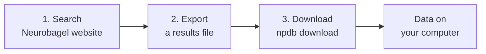

# What's available to you

NeuroPoly keeps its imaging datasets in one place and lets you search them like a catalogue. You pick the subjects you need, and a small tool downloads them for you.

## The three pieces

| | What it is | Where |
|-|------------|-------|
| **Neurobagel** | A search website. Filter subjects by age, sex, diagnosis, type of scan... across all lab datasets at once. | <https://data.neuro.polymtl.ca/bagel> |
| **NeuroGitea** | The lab's data server. Every dataset lives there, organized in the [BIDS](https://bids.neuroimaging.io) format. | <https://data.neuro.polymtl.ca> |
| **npdb** | A command you type in a terminal. It reads your Neurobagel results and downloads only those subjects from NeuroGitea. | your computer |

## What you can do

- **Browse** what data exists, without downloading anything.
- **Build a cohort**: e.g. "all females with a T2-weighted spinal cord scan".
- **Download exactly that cohort**, from several datasets in one go, without cloning whole datasets.

## What you need

- The Polytechnique **VPN** when you're off campus.
- To be a member of the **[neuropoly GitHub organization](https://github.com/neuropoly)** (to open Neurobagel).
- A **NeuroGitea account** (to download).

Setting these up is a one-time job: [Get access](get-access.md).

## Next steps

1. [Get access](get-access.md)
2. [Install npdb](install.md)
3. [Find data](find-data.md)
4. [Download data](download-data.md)
5. Put it together: [Tutorial: your first cohort](tutorial-first-cohort.md)

Want to add or curate datasets, or go further? See the [wiki](https://github.com/neuropoly/neuropoly-db/wiki).
