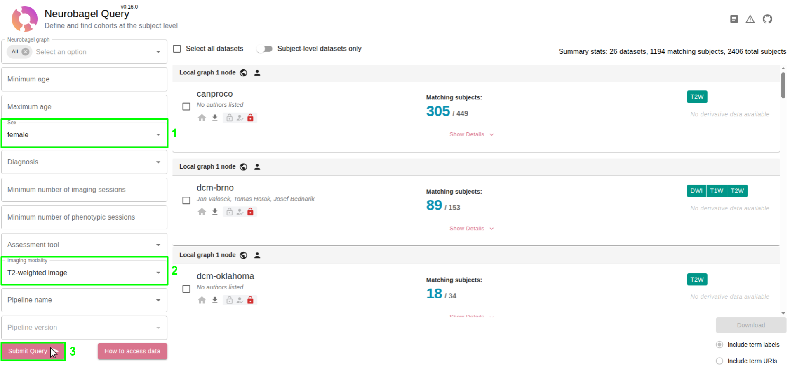
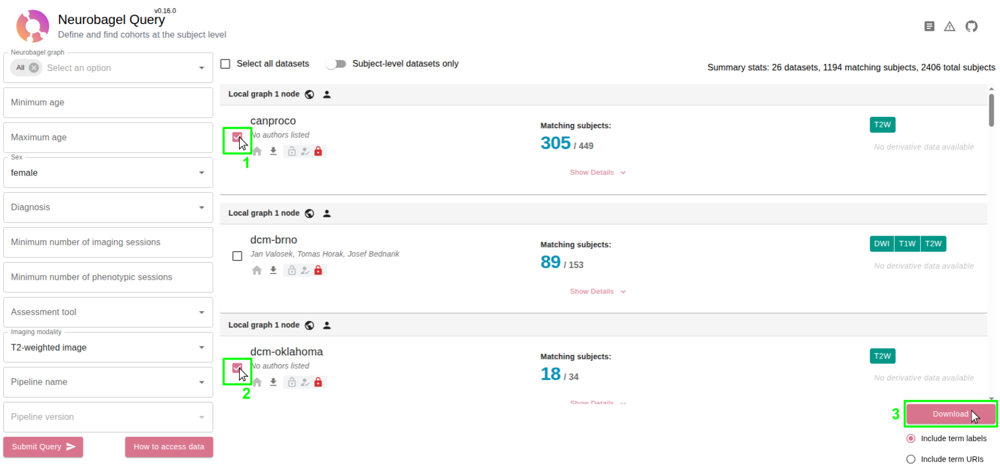

# Tutorial: your first cohort

Goal: get **all female subjects with a T2-weighted scan** from two datasets, on your computer.

Before you start, complete [Get access](get-access.md) and [Install npdb](install.md).

## 1. Search

1. Connect to the VPN (off campus).
2. Open <https://data.neuro.polymtl.ca/bagel>.
3. Set **Sex** to `female` and **Imaging modality** to `T2-weighted image`.
4. Click **Submit Query**.



The summary at the top right tells you how many datasets and subjects match. Each card shows matching subjects out of the total, e.g. `canproco`: **305** / 449.

## 2. Pick datasets and export

1. Tick **canproco** and **dcm-oklahoma**.
2. Click **Download** (bottom right).
3. Save the file as `females-t2w.tsv` in `~/neuropoly-data` (the folder with your `.env`).



## 3. Look at the results file (optional)

Open `females-t2w.tsv` in Excel or LibreOffice. You should only see the two datasets, female subjects, and `T2w` in `SessionImagingModalities`.

## 4. Download

```bash
cd ~/neuropoly-data
npdb download --no-verify-ssl females-t2w.tsv -o females-t2w
```

Downloading only raw scans, without processed files:

```bash
npdb download --no-verify-ssl --no-derivatives females-t2w.tsv -o females-t2w
```

## 5. Check what you got

```bash
ls females-t2w
ls females-t2w/canproco
```

You should see one folder per dataset, and inside, one `sub-...` folder per subject with the `T2w` images.

## Going further

- Repeat with other filters (age range, diagnosis) and compare the numbers.
- Learn how the lab organizes data on NeuroData: [wiki tutorial, part 2](https://github.com/neuropoly/neuropoly-db/wiki/Tutorial-2-NeuroData).
- Want to **add your own dataset** to Neurobagel? That's curation: see the [wiki tutorials, parts 4 and 5](https://github.com/neuropoly/neuropoly-db/wiki/Tutorial-4-NeuroData-to-Neurobagel).
